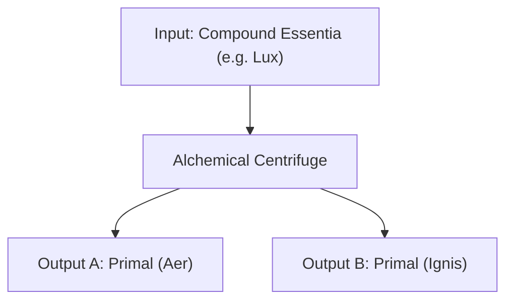

# Centrifuge & Crystallizer

**Category:** Alchemy | [Return to Wiki Home](Home)

---

## Overview

As your alchemy operations grow, you will encounter situations where you need raw primal aspects that are trapped inside complex compound essentia, or where liquid storage becomes unwieldy. The **Alchemical Centrifuge** and **Essentia Crystallizer** solve these logistics challenges.

---

## The Alchemical Centrifuge

The Centrifuge is an electric/arcane motorized device that spins liquid essentia at hyper speed, separating compound aspects into their two constituent components.

### Operation:
1. Connect an Essentia Tube input to the bottom port of the Centrifuge.
2. Pipe in any compound essentia (for example, *Lux*).
3. The Centrifuge will spin with high-pitched gears and output its two parent aspects (*Aer* and *Ignis*) from its upper output ports.

> [!TIP]
> The Centrifuge is the best way to generate rare or high-demand primals (like *Ordo* or *Perditio*) from abundant junk compounds like *Vitreus* or *Motus*.

---

## The Essentia Crystallizer

The Crystallizer transforms volatile liquid essentia into stable, stackable **Aspect Shards**.

### Benefits:
- **Compact Storage**: Shards stack up to 64 in standard chests, freeing up hundreds of glass jars.
- **Alchemical Feedstock**: Solid shards can be tossed directly back into Crucibles or dissolved into alembics whenever needed.

---

## Related Topics
- [Essentia Distillation](Essentia-Distillation)
- [Essentia Transport & Piping](Essentia-Transport-&-Piping)
- [The Thaumatorium](Thaumatorium)
- [Home](Home)
