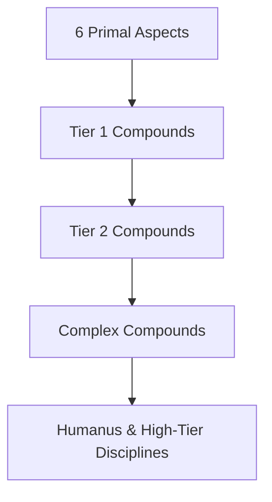

# Aspects of Magic Overview

**Category:** Aspects of Magic | [Return to Wiki Home](Home)

---

## Overview

In the world of **NeoThaum**, every block, creature, and item is composed of invisible spiritual essences known as **Aspects**. Aspects represent fundamental concepts, physical traits, and mystical affinities.

There are **6 Primal Aspects** and **48 Compound Aspects**, forming a vast hierarchical web of knowledge.

---

## The Forms of Aspects

Aspects exist in three distinct forms throughout your journey:

### 1. Research Aspects (Knowledge Pool)
Stored in the player's mind. When you scan items with a [Thaumometer](Scanning-&-Thaumometer) or deconstruct items at a Research Table, aspects are credited to your knowledge pool. These are consumed when solving research hexes in the Thaumonomicon.

### 2. Environmental Vis (Aura Nodes)
Ambient primal energy suspended in the aura. Unrefined vis exists naturally only as the six primal elements, stored inside [Aura Nodes](Aura-Nodes).

### 3. Physical Essentia (Liquid Magic)
When matter is smelted in an [Alchemical Furnace](Essentia-Distillation), its physical shell is destroyed, leaving behind pure liquid **Essentia**. Essentia is stored in [Warded Jars](Essentia-Storage), piped through tubes, and used to fuel [Infusion Altar](Infusion-Altar) rituals and [Crucible Alchemy](Crucible-Alchemy).

---

## Primal vs Compound Aspects

- **Primal Aspects** cannot be broken down further. They are the six foundation stones of the universe:
  - **Aer** (Air)
  - **Terra** (Earth)
  - **Ignis** (Fire)
  - **Aqua** (Water)
  - **Ordo** (Order)
  - **Perditio** (Entropy)

- **Compound Aspects** are formed by combining two simpler aspects. For example:
  $$	ext{Aqua} + 	ext{Terra} = 	ext{Victus (Life)}$$
  $$	ext{Victus} + 	ext{Perditio} = 	ext{Mortuus (Death)}$$
  $$	ext{Mortuus} + 	ext{Motus} = 	ext{Exanimis (Undead)}$$

---

## Research Aspect Combining

At the **Research Table**, if you run low on a specific aspect, you can synthesize it by clicking two component aspects on the illuminated wheel. 

> [!TIP]
> Always maintain a healthy pool of primal aspects by scanning environmental features (water, stone, obsidian, torch flames, skies) and tapping crafting tables with scribing tools.

---

## Related Topics
- [The Six Primal Aspects](Primal-Aspects)
- [Compound Aspects Chart](Compound-Aspects-Chart)
- [Scanning & Thaumometer](Scanning-&-Thaumometer)
- [Research Mechanics](Research-Mechanics)
- [Home](Home)
