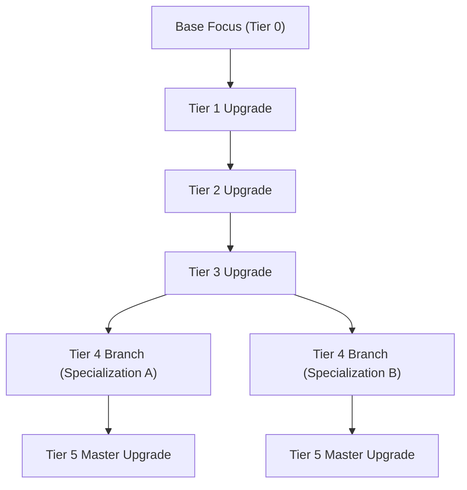

# The Focal Manipulator

**Category:** Thaumaturgy | [Return to Wiki Home](Home)

---

## Overview

The **Focal Manipulator** is an advanced enchanting station that allows you to customize and upgrade your [Wand Focuses](Wand-Focuses). Rather than vanilla anvil enchanting, the Focal Manipulator features branching specialization trees powered by player experience and primal vis.

---

## Construction & Setup

### Crafting Recipe (Arcane Worktable)
- 4x Arcane Stone Bricks
- 1x Quartz Block
- 1x Thaumium Ingot
- 1x Goggles of Revealing

Place the block in your workshop. To power high-tier upgrades, place it near an **Energized Vis Relay** or keep a charged wand in your inventory.

---

## Upgrade Categories

When a focus is placed into the manipulator, you can select up to **5 tiers of upgrades**:

### Universal Upgrades
- **Potency (I - V)**: Increases the primary damage or mining speed of the focus.
- **Frugal (I - V)**: Reduces the vis cost per activation by up to 35%.
- **Enlarged Area**: Expands the area-of-effect radius for Excavation and Fire.
- **Range**: Extends the maximum lock-on distance for projectile focuses.

### Specialization Branches
- **Fire Focus**: Can branch into *Alchemical Fire* (leaves lingering napalm puddles) or *Fireball* (launches explosive fireballs instead of a flame stream).
- **Excavation Focus**: Can branch into *Silk Touch* or *Fortune* (up to Fortune III).
- **Shock Focus**: Can branch into *Chain Lightning* (targets up to 5 additional mobs) or *Earth Shock* (summons ground-shattering lightning traps).

---

## Related Topics
- [Wand Focuses](Wand-Focuses)
- [Wands, Scepters & Staffs](Wands-and-Staffs)
- [Home](Home)
