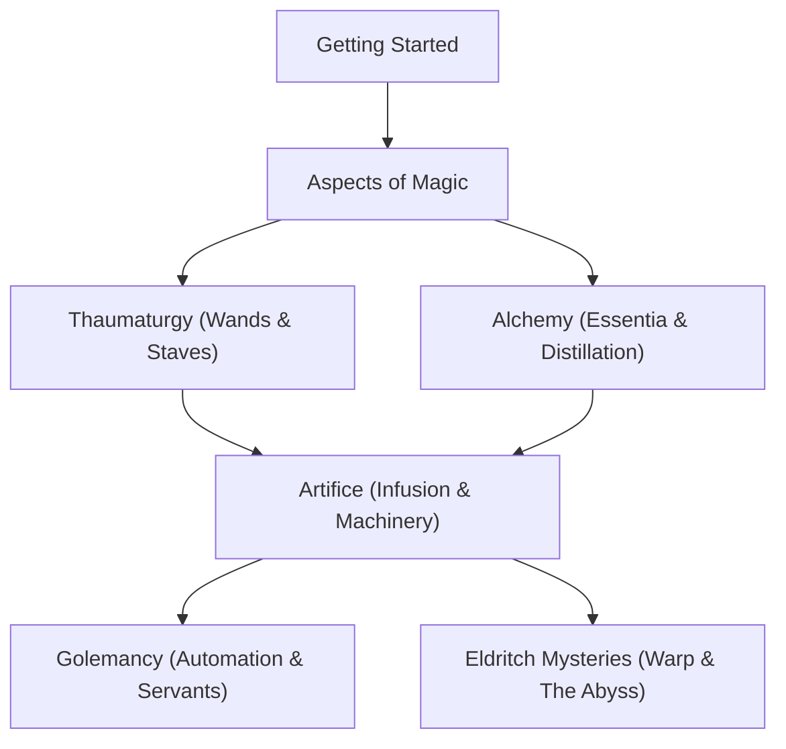

# Welcome to the NeoThaum Wiki

### *The comprehensive compendium of Arcane Knowledge, Thaumaturgy, and Eldritch Mysteries.*

---

## 📖 About NeoThaum

**NeoThaum** is an authentic recreation of Azanor's legendary magic mod **Thaumcraft 4.2.3.5** designed for modern Minecraft (**26.3 / 1.21.4+**) running on the Fabric toolchain. 

Whether you are an aspiring Thaumaturge picking up an Iron-Capped Wand for the very first time, or a veteran alchemist seeking to construct stabilized Infusion Altars and automate golem logistics, this wiki serves as your complete guide.

---

## 🧭 Navigation & Major Chapters

### 1. 🚀 [Getting Started](Getting-Started)
Everything you need to begin your magical career:
- [Getting Started Guide](Getting-Started) — Your first wand, Salis Mundus, and the Thaumonomicon.
- [Configuration & Settings](Configuration-&-Settings) — Customizing world generation, taint spread, and gameplay multipliers.
- [Mod Compatibility](Mod-Compatibility) — Native integrations with JEI, Jade, ModMenu, and Xaero's Maps.
- [Troubleshooting & FAQ](Troubleshooting-&-FAQ) — Resolving common questions and issues.

---

### 2. 🔮 [Aspects of Magic & Research](Aspects-Overview)
The building blocks of existence and how to decode them:
- [Aspects Overview](Aspects-Overview) — Fundamentals of primal vis and compound aspect synthesis.
- [The Six Primal Aspects](Primal-Aspects) — Aer, Terra, Ignis, Aqua, Ordo, and Perditio.
- [Compound Aspects Chart](Compound-Aspects-Chart) — Complete combination formulas for all compound aspects.
- [Scanning & Thaumometer](Scanning-&-Thaumometer) — Analyzing blocks, entities, and items.
- [Research Mechanics](Research-Mechanics) — The hex parchment research mini-game.
- [Aura Nodes](Aura-Nodes) — Types, modifiers, jar containment, and energizing transducers.
- [Node Tapping & Recharging](Node-Tapping-&-Recharging) — Recharging casting wands without depleting nodes.

---

### 3. 🪄 [Thaumaturgy](Wands-and-Staffs)
The tools of spellcasting and energy manipulation:
- [Wands, Scepters & Staffs](Wands-and-Staffs) — Rods, caps, scepters, and two-handed combat staves.
- [Wand Focuses](Wand-Focuses) — Fire, Frost, Shock, Excavation, Portable Hole, Warding, and more.
- [The Focal Manipulator](Focal-Manipulator) — Branching upgrade trees and focus customization.
- [Vis Storage & Robes](Vis-Storage-&-Discount-Armor) — Thaumaturge robes, goggles, and discount baubles.

---

### 4. 🧪 [Alchemy & Essentia](Crucible-Alchemy)
Refining matter into pure spiritual fluids:
- [Crucible Alchemy](Crucible-Alchemy) — Transmutation, boiling, and managing flux waste.
- [Essentia Distillation](Essentia-Distillation) — The Alchemical Furnace and Arcane Alembics.
- [Essentia Piping & Transport](Essentia-Transport-&-Piping) — Suction physics, directional tubes, buffers, and valves.
- [Essentia Storage](Essentia-Storage) — Warded Jars, Void Jars, Phials, and Aspect Labels.
- [The Thaumatorium](Thaumatorium) — Automated hands-free crucible transmutations.
- [Centrifuge & Crystallizer](Alchemical-Centrifuge-&-Crystallizer) — Splitting compound aspects and solidifying essentia.

---

### 5. ⚙️ [Artifice & Ancient Machinery](Infusion-Altar)
Constructing enchanted devices and multiblock wonders:
- [The Arcane Worktable](Arcane-Worktable) — Primal vis-powered item manufacturing.
- [The Infusion Altar](Infusion-Altar) — Multiblock runic matrix crafting, symmetry balancing, and instability.
- [Infusion Enchanting](Infusion-Enchanting) — Deterministic high-tier enchanting.
- [The Arcane Bore](Arcane-Bore) — Automated subterranean laser mining.
- [The Infernal Furnace](Infernal-Furnace) — Smelting with netherrack fire and bonus nugget yields.
- [Baubles & Runic Armor](Baubles-&-Runed-Armor) — Boots of the Traveller and rechargeable force fields.
- [Mirror Magic](Mirror-Magic) — Wireless inter-dimensional item and essentia conduits.
- [The Hungry Chest](Hungry-Chest) — Vacuum collection storage.

---

### 6. 🤖 [Golemancy](Golem-Basics-&-Materials)
Automated constructs that manage your base:
- [Golem Basics & Materials](Golem-Basics-&-Materials) — Clay, Wood, Straw, Flesh, Iron, Thaumium, and Tallow.
- [Animation Cores](Animation-Cores) — Gather, Harvest, Guard, Butcher, Decant, Fill, Empty, Use, and Sort.
- [Golem Upgrades & Accessories](Golem-Upgrades-&-Accessories) — Elemental upgrades, spectacles, and tiny hats.
- [Golem Control & The Bell](Golem-Control-&-Markers) — Task assignments and color-coded chest networks.
- [The Traveling Trunk](Traveling-Trunk) — Loyal walking companion chests.

---

### 7. 👁️ [Eldritch Mysteries & Warp](Warp-Mechanics)
Diving into forbidden knowledge and the darkness between the stars:
- [Warp Mechanics & Sanity](Warp-Mechanics) — Temporary, sticky, and permanent warp; psychic attacks and cures.
- [Eldritch Monuments](Eldritch-Worldgen) — Obelisks, runic altars, and portal frames.
- [The Crimson Cult](Crimson-Cult) — Crimson Knights, Clerics, Praetors, and the Crimson Rites.
- [Eldritch Horrors & Bosses](Eldritch-Mobs) — Eldritch Guardians, Crabs, and Golems.
- [Void Metal Equipment](Void-Metal-Equipment) — Self-repairing abyssal gear.
- [The Outer Lands](The-Outer-Lands) — Opening the portal to the labyrinth dimension.

---

### 8. 🌲 [World Generation & Flora](Biomes-&-Flora)
- [Biomes & Thaumic Flora](Biomes-&-Flora) — Magical Forests, Silverwood & Greatwood trees, and native plants.
- [Taint Mechanics](Taint-Mechanics) — Infection spread, tainted mobs, fibrous tendrils, and purification.
- [World Structures](Structures) — Barrow Mounds, Hilltop Stones, and Wizard Towers.
- [Ores & Deposits](Ore-Generation) — Infused Stone, Cinnabar, and Amber deposits.

---

*Use the **Sidebar** to jump directly to any topic.*
