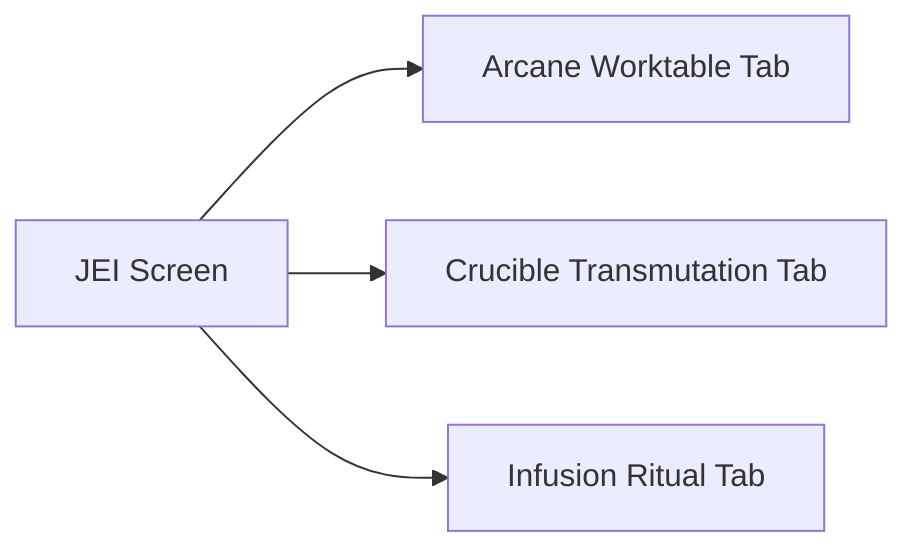

# Mod Compatibility & Integrations

**Category:** Getting Started | [Return to Wiki Home](Home)

---

## Overview

NeoThaum is built to integrate with the modern Fabric modding ecosystem. It includes native hooks, custom renderers, and custom GUI integration for popular utility and quality-of-life mods.

---

## Supported Integrations

### 1. Just Enough Items (JEI)
NeoThaum registers dedicated JEI plugin categories that display all custom thaumaturgical crafting methods:

- **Arcane Crafting**: Displays recipes requiring primal vis channeled from wands in the Arcane Worktable. Shows required vis crystals and wand aspect costs.
- **Crucible Alchemy**: Displays the boiling aspect requirements, catalyst item, and resulting transmutation output.
- **Infusion Altar Rituals**: Shows the central item, surrounding pedestal sacrifice ingredients, required liquid Essentia aspects, and instability rating (Negligible, Minor, Moderate, High, Dangerous).

---

### 2. Jade / Waila HUD
NeoThaum provides contextual in-world tooltips via Jade:

- **Aura Nodes**: When wearing the **Goggles of Revealing**, hovering over an Aura Node displays its exact node type (e.g. *Bright Hungry*, *Pure Normal*), and a full bar breakdown of its current vs maximum Vis for all present aspects.
- **Crucibles**: Shows whether the water is currently boiling and lists the dissolved aspect slurry contained within.
- **Essentia Jars & Alembics**: Displays the stored aspect name, icon, and current count (e.g., `48 / 64 Ignis`).
- **Pedestals & Matrix**: Displays the current item resting on pedestals and infusion progress.

---

### 3. ModMenu
NeoThaum implements the `ModMenuApi` interface, offering an interactive in-game settings screen that eliminates the need to edit raw JSON configuration files.

---

### 4. Xaero's World Map & Minimap
- **Discovered Node Overlay**: NeoThaum adds a dedicated button to Xaero's World Map GUI (placed neatly in the map controls column). Clicking this button toggles the display of discovered Aura Nodes on the world map.
- **Radar Entity Integration**: Minimap radar properly renders icons and threat rings for Tainted creatures, Eldritch Guardians, Crimson Cultists, and Champion mobs.

---

## Recommended Companion Mods Table

| Mod | Platform | Function |
| :--- | :--- | :--- |
| **[JEI](https://modrinth.com/mod/jei)** | Modrinth / CurseForge | Recipe viewer for Crucible, Arcane, and Infusion recipes. |
| **[Jade](https://modrinth.com/mod/jade)** | Modrinth / CurseForge | In-world block and entity HUD inspector. |
| **[ModMenu](https://modrinth.com/mod/modmenu)** | Modrinth / CurseForge | In-game configuration and settings editor. |
| **[Xaero's World Map](https://modrinth.com/mod/xaeros-world-map)** | Modrinth / CurseForge | Fullscreen global map with Aura Node markers. |
| **[Xaero's Minimap](https://modrinth.com/mod/xaeros-minimap)** | Modrinth / CurseForge | Radar and waypoint tracking. |

---

## Related Topics
- [Getting Started](Getting-Started)
- [Configuration & Settings](Configuration-&-Settings)
- [Home](Home)
