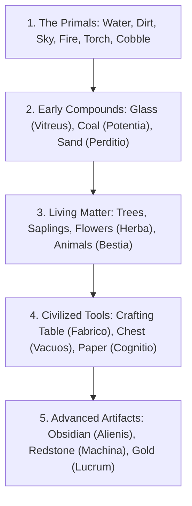

# Scanning & The Thaumometer

**Category:** Basic Information & Research | [Return to Wiki Home](Home)

---

## Overview

The **Thaumometer** is the primary scientific apparatus of a Thaumaturge. Pointing and scanning the Thaumometer at the world uncovers the invisible aspect composition of matter and deposits knowledge directly into your research inventory.

---

## How to Scan

1. Place the **Thaumometer** in your main hand.
2. Aim your crosshair at any world block, dropped entity item, or living mob.
3. Hold **Right-Click** for approximately 1.5 seconds.
4. You will see runic particles concentrate toward your reticle:
   - **Success (Chime & Aspects Displayed)**: The item's constituent aspects appear in the lower-right corner of your screen, and points are added to your research ledger.
   - **Failure (You lack the research to understand this)**: The target contains a compound aspect you have not yet synthesized or discovered.
   - **Already Scanned**: The HUD notifies you that you have already analyzed this subject.

---

## Scanning Progression Roadmap

To build your aspect knowledge efficiently, follow this early-game scanning sequence:

### Essential Early Scans:
- **Water Bucket / Ocean**: Unlocks abundant `Aqua`.
- **Torch / Fire**: Unlocks `Ignis` and `Lux`.
- **Dirt / Stone / Sand**: Unlocks `Terra` and `Perditio`.
- **Wool / Leather / Raw Beef**: Unlocks `Bestia` and `Victus`.
- **Crafting Table**: Unlocks `Fabrico`, `Instrumentum`, and `Arbor`.
- **Bookshelf / Paper**: Unlocks `Cognitio` and `Spiritus`.

---

## Research Point Economy

- Each unique scan permanently grants between **1 to 5 research points** for each aspect contained within that object.
- Mobs reward higher point yields upon first scan (e.g. Creepers provide `Ignis`, `Perditio`, and `Metus`).
- Celestial bodies (Sun, Moon) and weather conditions (Rain, Thunderstorm) can also be scanned!

---

## Related Topics
- [Aspects Overview](Aspects-Overview)
- [The Six Primal Aspects](Primal-Aspects)
- [Research Mechanics](Research-Mechanics)
- [Home](Home)
