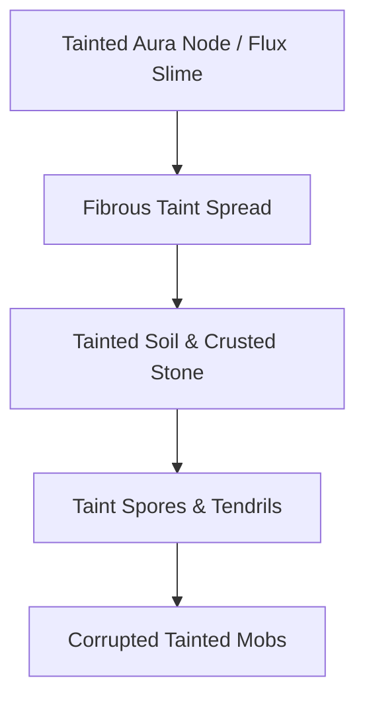

# Taint Mechanics & Corruption

**Category:** World Generation | [Return to Wiki Home](Home)

---

## Overview

**Taint** is an invasive mystical blight—a virulent magical pathogen that infects the terrain, transforms living animals into aggressive husks, and pollutes the atmospheric aura. If left unchecked, a localized taint spore can consume entire biomes.

---

## Propagation Dynamics

1. **Fibrous Taint**: Creeps across the ground like a purple fungus, converting grass and dirt into **Tainted Soil**, and stone into **Crusted Taint**.
2. **Taint Spores**: Explosive fungal pods that burst when approached, showering victims with poison and spreading fresh taint.
3. **Tendrils**: Attacking tentacles that emerge from infected blocks to strike nearby players.

---

## Tainted Creatures

When ordinary passive animals dwell on tainted soil or are struck by taint attacks, they mutate:
- **Tainted Sheep**: Wool falls off, replaced by purple crust.
- **Tainted Pigs / Cows**: Aggressive monstrosities that hunt down uninfected wildlife.
- **Tainted Crawlers**: Vicious swarming centipedes that scuttle through infected caves.

---

## Curing and Repelling Taint

To protect your base from corruption:

### 1. The Ethereal Bloom
- A radiant white flower crafted in the [Crucible](Crucible-Alchemy) using Shimmerleaf, *Praecantatio*, *Sano*, and *Herba*.
- Radiates a 16-block purifying aura that permanently cures tainted soil back to clean grass and kills taint tendrils.

### 2. Planting Silverwoods
- Planting Silverwood saplings creates a **Pure Node**, naturally reclaiming tainted land into lush Magical Forest.

---

## Related Topics
- [Biomes & Thaumic Flora](Biomes-&-Flora)
- [Crucible Alchemy](Crucible-Alchemy)
- [Configuration & Settings](Configuration-&-Settings)
- [Home](Home)
