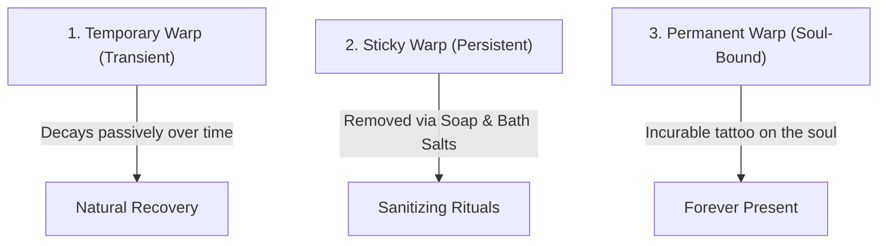

# Warp Mechanics & Sanity

**Category:** Eldritch Mysteries | [Return to Wiki Home](Home)

---

## Overview

**Warp** is the mystical psychosis and psychological corruption that infects a Thaumaturge who delves into forbidden lore, meddles with the dark arts, or handles raw eldritch matter. As your Warp accumulates, the fabric of your mind frays, producing horrific hallucinations, bodily afflictions, and otherworldly incursions.

---

## The Three Tiers of Warp

Warp exists in three distinct layers in your character's soul:

### 1. Temporary Warp
- **Gained from:** Casting dark spells (e.g. *Focus: Primal*), crafting dark items, or being struck by Eldritch Guardians.
- **Duration:** Gradually dissipates on its own over time.

### 2. Sticky Warp
- **Gained from:** Unlocking purple-bordered forbidden research entries in the Thaumonomicon.
- **Duration:** Does not fade passively; must be cleansed using alchemical purifiers.

### 3. Permanent Warp
- **Gained from:** Discovering epochal forbidden revelations (such as the *Eldritch Epiphany*).
- **Duration:** Cannot be cleansed; permanently stays with the player.

---

## Warp Symptoms & Manifestations

As your warp level rises, random psychotomimetic warp events will trigger unexpectedly:

| Symptom | Severity | Description |
| :--- | :---: | :--- |
| **Auditory Whispers** | Low | Eerie whispers, heartbeat thumping, and cave rattles playing in your ears. |
| **Phantom Spiders** | Low | Illusory ghostly spiders swarm your screen; they disappear when struck. |
| **Unnatural Hunger** | Medium | Extreme ravenous hunger; eating food inflicts Rotting Flesh sickness. |
| **Sun Sickness** | Medium | Standing under direct sunlight causes burning blindness and nausea. |
| **Eldritch Vision** | Medium | Shifting rainbow fog and cosmic tunnel vision. |
| **Mind Spiders** | High | Actual physical poisonous spiders burst from your body. |
| **Guardian Incursion** | High | Tall shadowy **Eldritch Guardians** tear through the veil and attack! |

---

## Cleansing Warp & Protecting Your Sanity

### 1. Sanitizing Soap
- Crafted from tallow, water, and pure essentia.
- Right-clicking and using the soap scrubs away a portion of your **Sticky Warp**.

### 2. Purifying Bath Salts
- Tossed into a pool of water to create a soothing spa.
- Soaking in the bath grants the **Warp Ward** buff, completely suppressing all warp manifestations for several real-time hours!

---

## Related Topics
- [Eldritch Monuments](Eldritch-Worldgen)
- [The Crimson Cult](Crimson-Cult)
- [Void Metal Equipment](Void-Metal-Equipment)
- [Home](Home)
